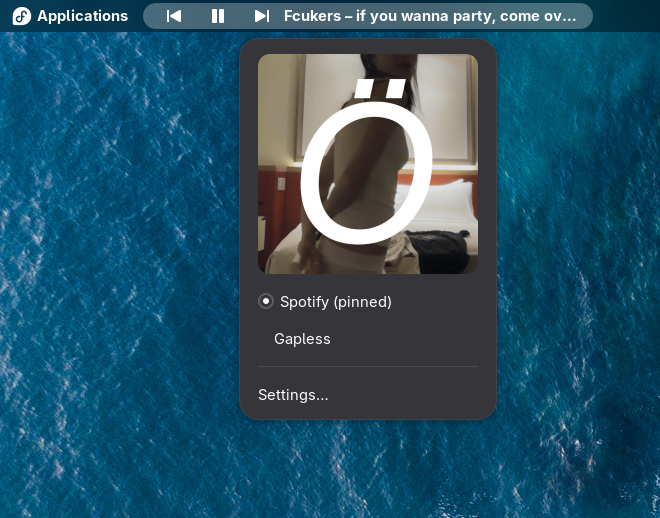

# Now Playing



A GNOME Shell extension that shows the current song in the left side of the top panel, with previous / play-pause / next buttons. It works with any media player that supports MPRIS (Spotify, Firefox, Chromium, VLC, mpv with MPRIS, …). It only appears while something is playing.

## Features

- **Artist – Title** label in the left panel box, falling back to the title alone, or the player's name when there is no title.
- **Inline controls:** previous, play/pause and next. Each can be hidden individually in the preferences.
- **Long titles:** truncate with an ellipsis, or scroll back and forth as a marquee, up to a configurable maximum width.
- **Hidden when idle:** the indicator disappears when nothing is playing. After a pause it stays for a configurable delay (default 30 s), or until the player stops if you choose "never".
- **Several players:** the most recently started player is shown. When it pauses, the label falls back to another one that is still playing.
- **Popup** (click the label):
  - cover art, if the player provides it. Click it to bring the player's window to the front;
  - a list of players; click one to pin it, click again to unpin;
  - a link to the settings.
- **Optional whitelist:** show only the players you pick, chosen from the players detected on your system or entered by name.

## Requirements

GNOME Shell 50.

## Installation

From a clone of this repository:

```bash
make schemas
ln -s "$PWD" ~/.local/share/gnome-shell/extensions/now-playing@methical
```

Or build and install a zip:

```bash
make pack
gnome-extensions install --force now-playing@methical.shell-extension.zip
```

On Wayland, log out and back in so the Shell discovers the extension. Then enable it:

```bash
gnome-extensions enable now-playing@methical
```

If you installed from the zip and the preferences don't open, make sure `schemas/gschemas.compiled` exists in the installed extension folder. If it doesn't, run `glib-compile-schemas` on that folder.

## Preferences

Open them from the popup ("Settings…") or with `gnome-extensions prefs now-playing@methical`.

| Setting | Meaning | Default |
|---|---|---|
| Long text | Ellipsis or marquee | Ellipsis |
| Maximum width | Width of the label in pixels | 300 |
| Buttons | Show previous / play-pause / next | All on |
| Hide indicator | After a delay, or never while a track is loaded | After a delay |
| Delay | Seconds to stay visible after a pause; 0 hides immediately | 30 |
| Whitelist | Only show the listed players | Off |

With the whitelist on and no players listed, nothing is shown.

## Development

```bash
make test          # unit tests (plain gjs, no Shell needed)
make integration   # adapter test against a fake MPRIS player on a private bus
make schemas       # recompile the GSettings schema after editing it
make pack          # build the installable zip
```

To try it with a fake player:

```bash
FAKE_TITLE="Karma Police" FAKE_ARTIST="Radiohead" gjs -m tests/fake-player.js
```

`FAKE_NAME`, `FAKE_ART` (for example `file:///path/to/image.png`) and `FAKE_STATUS` (`Playing` or `Paused`) are also supported.

The player logic (`tracker.js`, `util.js`) is free of Shell imports, which keeps it testable without a running Shell. See [`AGENTS.md`](AGENTS.md) for architecture notes and pitfalls, and `docs/superpowers/` for the design spec and implementation plan.

## License

Copyright (C) methical. Licensed under the [GNU General Public License v3.0 or later](LICENSE) (GPL-3.0-or-later).
